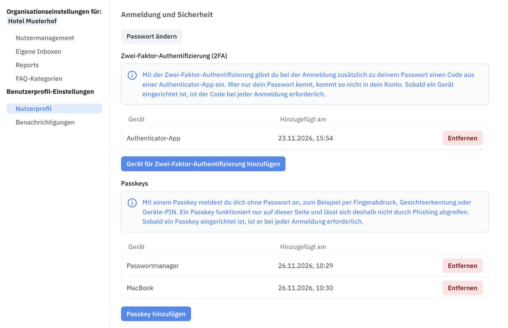
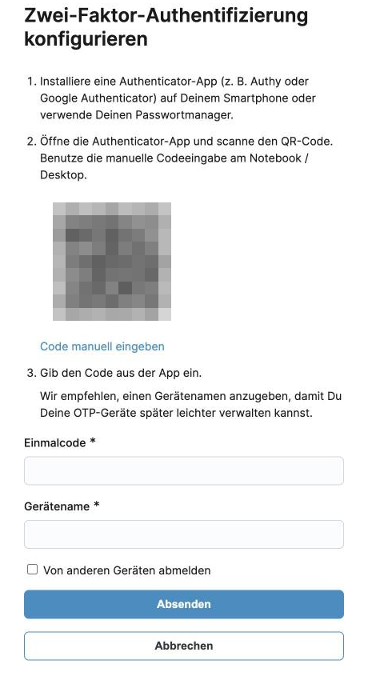
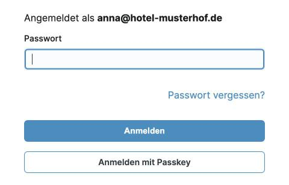
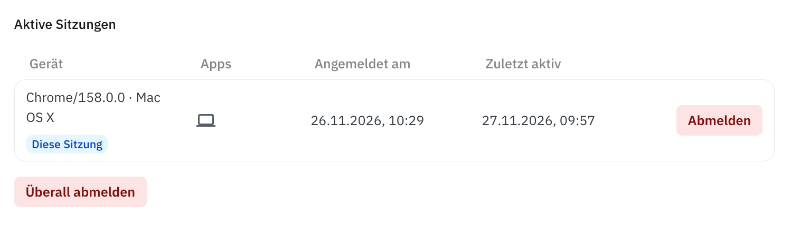
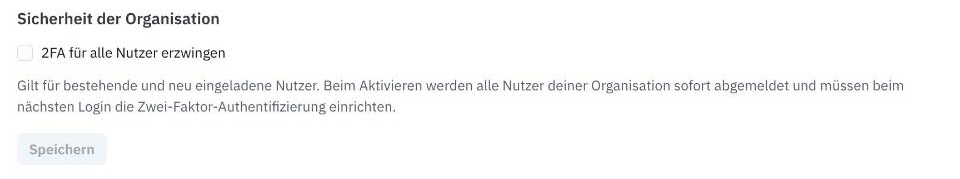
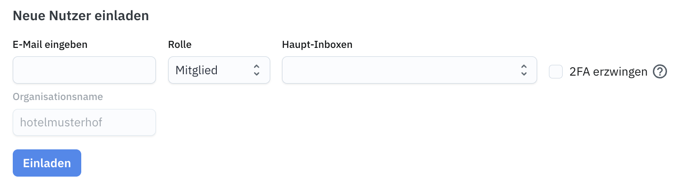
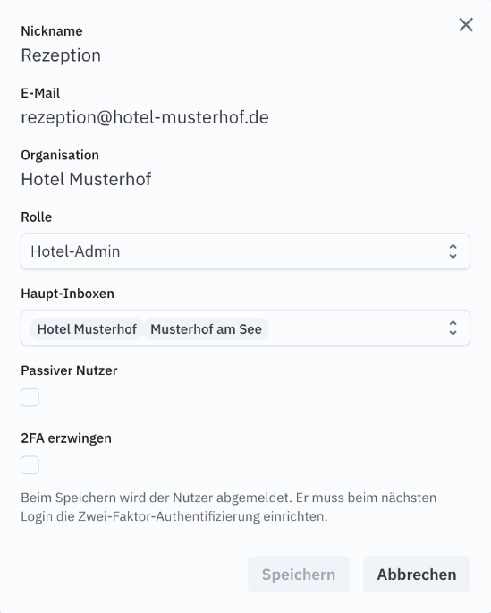
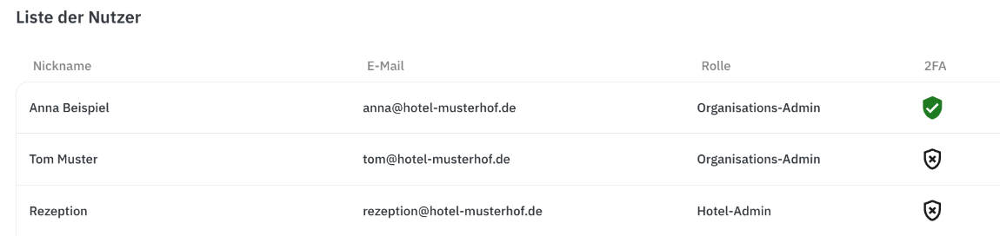

Du kannst deinen Zugang zur DialogShift App zusätzlich zum Passwort absichern. Dafür gibt es Einmalcodes aus einer Authenticator-App (Zwei-Faktor-Authentifizierung, kurz 2FA) und Passkeys. Beides ist freiwillig, solange ein Admin deiner Organisation 2FA nicht vorgibt. Wir empfehlen 2FA allen Nutzern, besonders Admins und allen, die mehrere Hotels betreuen.

## Wo du die Einstellungen findest

Öffne in der DialogShift App **Organisation** und dann **Nutzerprofil**. Im Abschnitt **Anmeldung und Sicherheit** findest du untereinander **Passwort ändern**, **Zwei-Faktor-Authentifizierung (2FA)**, **Passkeys** und **Aktive Sitzungen**.

<Frame>
  
</Frame>

<Note>
  Richte 2FA und Passkeys nur hier im Nutzerprofil ein. DialogShift schickt dir dafür keinen Link per E-Mail, SMS oder WhatsApp.
</Note>

## Zwei-Faktor-Authentifizierung einrichten

Mit 2FA gibst du bei der Anmeldung zusätzlich zu deinem Passwort einen 6-stelligen Code aus einer Authenticator-App ein. Wer nur dein Passwort kennt, kommt so nicht in dein Konto.

Du brauchst eine Authenticator-App auf deinem Smartphone, zum Beispiel Google Authenticator oder Authy. Ein Passwortmanager, der Einmalcodes erzeugt, funktioniert genauso.

1. Klick im Nutzerprofil auf **Gerät für Zwei-Faktor-Authentifizierung hinzufügen**.
2. Bestätige dein Passwort oder deinen Passkey, wenn die Anmeldeseite danach fragt.
3. Scanne den QR-Code mit deiner Authenticator-App. Läuft die App oder dein Passwortmanager auf demselben Gerät, klick auf **Code manuell eingeben** und übernimm den angezeigten Schlüssel.
4. Trag bei **Einmalcode** den Code aus der App ein.
5. Vergib bei **Gerätename** einen Namen, an dem du das Gerät später wiedererkennst, zum Beispiel "iPhone Rezeption".
6. Klick auf **Absenden**.

<Frame>
  
</Frame>

Danach bist du wieder im Nutzerprofil und siehst das Gerät in der Tabelle. Sobald ein Gerät eingerichtet ist, ist der Code bei jeder Anmeldung erforderlich.

Du kannst mehrere Geräte hinzufügen, jedes erzeugt gültige Codes.

## Passkey einrichten

Mit einem Passkey meldest du dich ohne Passwort an, zum Beispiel per Fingerabdruck, Gesichtserkennung oder Geräte-PIN. Ein Passkey funktioniert nur auf der Anmeldeseite der DialogShift App und lässt sich deshalb nicht durch Phishing abgreifen. Passkeys gibt es am Computer und am Smartphone.

1. Klick im Nutzerprofil auf **Passkey hinzufügen**.
2. Bestätige dein Passwort oder deinen Passkey, wenn die Anmeldeseite danach fragt.
3. Folge den Schritten, die dein Browser oder dein Betriebssystem anzeigt, und speichere den Passkey zum Beispiel mit Touch ID, Windows Hello, deinem Smartphone oder deinem Passwortmanager.

Bei der nächsten Anmeldung klickst du auf **Anmelden mit Passkey**.

<Frame>
  
</Frame>

Unser Tipp: Richte zuerst eine Authenticator-App ein und ergänze danach einen Passkey als bequemen Login. Mit zwei Methoden kommst du auch dann in dein Konto, wenn eine davon ausfällt.

## Geräte und Passkeys entfernen

Klick in der Tabellenzeile auf **Entfernen** und bestätige das Löschen auf der Anmeldeseite.

Sobald du 2FA oder einen Passkey eingerichtet hast, bleibt immer mindestens eine Methode bestehen. Beim letzten verbliebenen Eintrag ist **Entfernen** deshalb ausgegraut. Füge zuerst ein weiteres 2FA-Gerät oder einen Passkey hinzu, dann lässt sich der alte Eintrag entfernen.

## Aktive Sitzungen prüfen

Unter **Aktive Sitzungen** siehst du alle Geräte, auf denen du gerade angemeldet bist.

<Frame>
  
</Frame>

| Spalte | Inhalt |
| --- | --- |
| **Gerät** | Browser und Betriebssystem. Die Sitzung, die du gerade nutzt, trägt das Label **Diese Sitzung**. |
| **Apps** | Ein Symbol pro Anwendung, die in dieser Sitzung angemeldet ist. Laptop steht für die DialogShift App, Smartphone für die DialogShift Mobile App, Briefumschlag für Email AI. |
| **Angemeldet am** | Zeitpunkt der Anmeldung |
| **Zuletzt aktiv** | Letzter Zugriff in dieser Sitzung |

- Mit **Abmelden** beendest du eine einzelne Sitzung. Wer sie nutzt, muss sich neu anmelden.
- Mit **Überall abmelden** beendest du alle Sitzungen, auch die aktuelle. Danach meldest du dich auf jedem Gerät neu an.

Erkennst du eine Sitzung nicht wieder, klick auf **Überall abmelden**, ändere danach dein Passwort und richte 2FA ein.

## Kein Zugriff mehr auf deine Authenticator-App

Hast du dein Smartphone verloren oder die Authenticator-App gelöscht, setzt ein Admin deiner Organisation deine 2FA im Nutzermanagement zurück. Das geht nur, wenn der Admin eine höhere Rolle hat als du. Danach meldest du dich mit deinem Passwort an. Ist 2FA für dich vorgegeben, richtest du sie bei dieser Anmeldung neu ein.

Hast du einen Passkey als zweite Methode, meldest du dich einfach damit an, fügst ein neues 2FA-Gerät hinzu und entfernst das alte.

## Für Admins: 2FA vorgeben und zurücksetzen

Alle folgenden Einstellungen findest du unter **Organisation** und dann **Nutzermanagement**.

### 2FA für die ganze Organisation erzwingen

Diesen Abschnitt sehen Nutzer mit der Rolle **Organisations-Admin**.

1. Setz unter **Sicherheit der Organisation** den Haken bei **2FA für alle Nutzer erzwingen**.
2. Klick auf **Speichern**.

<Frame>
  
</Frame>

Das passiert beim Aktivieren:

- Die Vorgabe gilt für bestehende und neu eingeladene Nutzer.
- Alle Nutzer deiner Organisation werden sofort abgemeldet. Wer noch keine 2FA hat, richtet sie bei der nächsten Anmeldung ein.
- Im Einladungsformular und im Dialog **Ändern** lässt sich die Vorgabe für einzelne Nutzer nicht mehr umstellen.

Nimmst du den Haken wieder heraus, bleibt die Vorgabe bei allen Nutzern und Einladungen bestehen, die sie schon haben. Für neue Einladungen wählst du sie dann wieder einzeln. Bei einem bestehenden Nutzer nimmst du sie im Dialog **Ändern** heraus, solange er 2FA noch nicht eingerichtet hat.

<Note>
  Stell die Vorgabe am besten außerhalb der Hauptzeit an der Rezeption um, weil alle Nutzer sofort abgemeldet werden.
</Note>

### 2FA für einzelne Nutzer erzwingen

Das geht ab der Rolle **Hotel-Admin**.

**Beim Einladen:** Setz im Formular **Neue Nutzer einladen** den Haken bei **2FA erzwingen**. Der Nutzer richtet 2FA dann beim ersten Login ein.

<Frame>
  
</Frame>

**Bei offenen Einladungen:** In der Tabelle **Eingeladene Nutzer** zeigt die Spalte **2FA** ein Schild. Mit einem Klick darauf schaltest du die Vorgabe um.

**Bei bestehenden Nutzern:** Klick in der **Liste der Nutzer** auf **Ändern**, setz den Haken bei **2FA erzwingen** und klick auf **Speichern**. Der Nutzer wird dabei abgemeldet und richtet 2FA beim nächsten Login ein. Als Hotel-Admin oder Marken-Admin musst du dafür alle Inboxen dieses Nutzers verwalten. Hat der Nutzer 2FA bereits eingerichtet, ist der Haken gesperrt. Für dein eigenes Konto richtest du 2FA in deinem Nutzerprofil ein.

<Frame>
  
</Frame>

### 2FA-Status deiner Nutzer sehen

In der **Liste der Nutzer** zeigt die Spalte **2FA** den Stand jedes Nutzers.

<Frame>
  
</Frame>

| Symbol | Bedeutung |
| --- | --- |
| Grünes Schild mit Haken | 2FA ist eingerichtet. |
| Schild mit Haken als Umriss | 2FA ist erzwungen, aber noch nicht eingerichtet. |
| Schild mit Kreuz | 2FA ist weder eingerichtet noch erzwungen. |

### 2FA eines Nutzers zurücksetzen

Hat ein Nutzer keinen Zugriff mehr auf seine Authenticator-App, klick in der **Liste der Nutzer** in seiner Zeile auf **2FA zurücksetzen** und bestätige. Damit werden alle 2FA-Methoden dieses Nutzers entfernt, auch seine Passkeys. Ist 2FA erzwungen, richtet der Nutzer sie beim nächsten Login neu ein.

Die Schaltfläche erscheint unter diesen Bedingungen:

- Du hast mindestens die Rolle **Hotel-Admin**.
- Der Nutzer hat 2FA eingerichtet und eine niedrigere Rolle als du.
- Als Hotel-Admin oder Marken-Admin verwaltest du alle Inboxen des Nutzers.

Dein eigenes Konto kannst du nicht zurücksetzen. Richte als Admin deshalb zwei Methoden ein, zum Beispiel eine Authenticator-App und einen Passkey.

Vergewissere dich vor dem Zurücksetzen, dass die Bitte wirklich von der Person selbst kommt.
